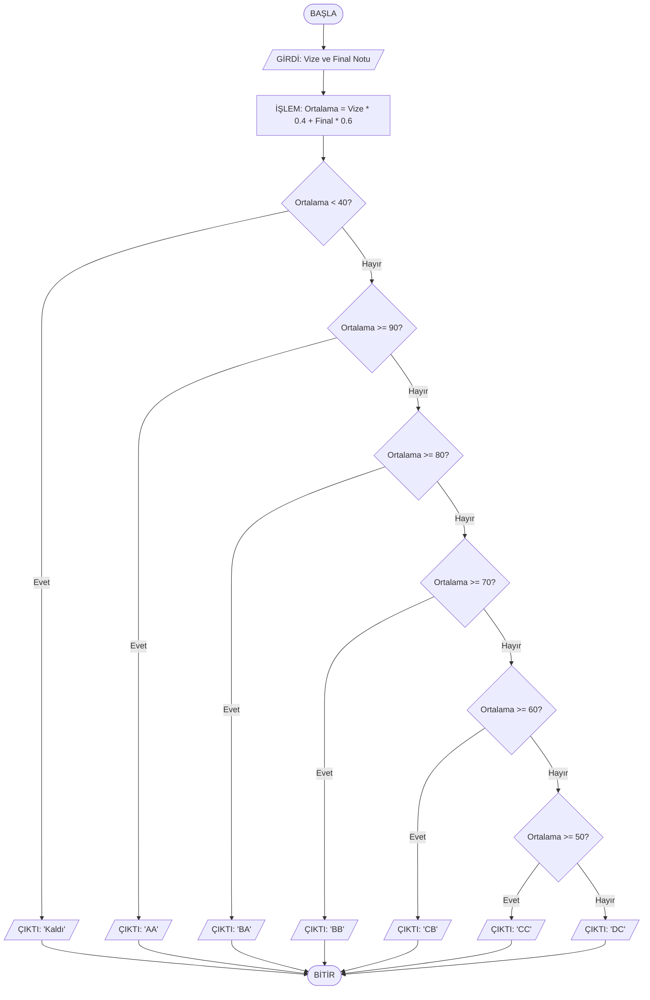

# YZM101 - Ödev: Algoritma ve Dokümantasyon

* **Öğrenci Adı Soyadı:** Ömer Muhammed Kamil Elzuhari
* **Öğrenci Numarası:** 250411079
* **Seçilen Senaryo:** Senaryo B (Öğrenci Not Değerlendirme)

## 1. Problem Tanımı ve Süreç
Bu sistem, bir öğrencinin vize ve final notlarını girdi olarak alır. Alınan bu notların belirli ağırlıklarına göre (%40 vize, %60 final) ağırlıklı ortalamasını hesaplar. Eğer hesaplanan ortalama 40 puanın altında ise öğrenci doğrudan "Kaldı" sayılır; 40 ve üstünde ise ortalamaya karşılık gelen harf notu aralığını belirleyerek sonucu çıktı olarak üretir.

## 2. Sözde Kod (Pseudocode)
```text
1. BAŞLA
2. GİRDİ: vize_notu, final_notu
3. İŞLEM: ortalama = (vize_notu * 0.40) + (final_notu * 0.60)
4. EĞER (ortalama < 40) İSE:
5.     ÇIKTI: "Kaldı"
6. DEĞİLSE:
7.     EĞER (ortalama >= 90) İSE ÇIKTI: "AA"
8.     EĞER (ortalama >= 80 VE ortalama < 90) İSE ÇIKTI: "BA"
9.     EĞER (ortalama >= 70 VE ortalama < 80) İSE ÇIKTI: "BB"
10.    EĞER (ortalama >= 60 VE ortalama < 70) İSE ÇIKTI: "CB"
11.    EĞER (ortalama >= 50 VE ortalama < 60) İSE ÇIKTI: "CC"
12.    EĞER (ortalama >= 40 VE ortalama < 50) İSE ÇIKTI: "DC"
13. BİTİR
```

## 3. Akış Şeması (Flowchart)


## 4. Kullanılan Araçlar ve Karşılaşılan Zorluklar
* **Akış Şeması Aracı:** draw.io
* **Kışá Değerlendirme:** Bu ödevi tamamlarken en çok zorlandığınız nokta, harf notu aralıklarının karar bloklarını akış şemasında ardışık olarak doğru ve düzenli bir şekilde yerleştirmek oldu.

## 5. Depo Bağlantısı
[https://github.com](https://github.com)
